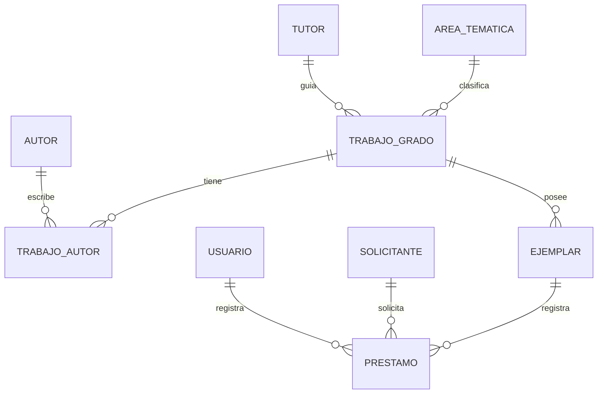

# Sistema Web para el Registro y Control de Trabajos de Grado

**Biblioteca de Ingeniería de Sistemas — UPEA** · Ingeniería de Sistemas I (SIS-745) · Grupo 8

Implementación en **Flask** del diseño del Capítulo III del proyecto. Arquitectura **monolítica modular** con **SQLAlchemy** como ORM, **blueprints** por proceso y patrones creacionales (**Factory Method** y **Builder**). Base de datos **SQLite**. Permite registrar trabajos de grado y sus ejemplares, gestionar solicitantes, controlar préstamos internos y externos, y generar reportes de uso de la biblioteca.

---

## Tabla de contenido

1. [Características principales](#1-características-principales)
2. [Stack y requisitos](#2-stack-y-requisitos)
3. [Instalación](#3-instalación)
4. [Configuración](#4-configuración)
5. [Uso](#5-uso)
6. [Roles y permisos](#6-roles-y-permisos)
7. [Requisitos funcionales](#7-requisitos-funcionales)
8. [Requisitos no funcionales](#8-requisitos-no-funcionales)
9. [Reglas de negocio](#9-reglas-de-negocio)
10. [Esquema de la base de datos](#10-esquema-de-la-base-de-datos)
11. [Estructura del proyecto](#11-estructura-del-proyecto)
12. [Pruebas](#12-pruebas)
13. [Respaldo de la base de datos](#13-respaldo-de-la-base-de-datos)
14. [Publicación en internet](#14-publicación-en-internet)
15. [Advertencias y limitaciones](#15-advertencias-y-limitaciones)
16. [Documentación adicional](#16-documentación-adicional)

---

## 1. Características principales

- Registro de material bibliográfico: libros y trabajos de grado (tesis, proyecto de grado, trabajo dirigido) con autores, tutor, área temática y ejemplares.
- Modalidad **Libro** con ejemplares prestables y búsqueda dentro del mismo catálogo.
- Carga opcional de 12 libros famosos de desarrollo de software con `seed-libros`.
- Baja lógica de material, conservando el historial de préstamos.
- Catálogo con búsqueda por título, autor, área, gestión y modalidad, **sin distinguir tildes ni mayúsculas**.
- Gestión de solicitantes (estudiantes y docentes) por CI o matrícula.
- Préstamos **internos** (consulta en sala) y **externos** (a domicilio), con devoluciones, renovaciones y alertas de retraso.
- Expedición de **comprobante imprimible** de préstamo.
- Nueve reportes con impresión/PDF y **exportación a CSV**.
- Catálogo público de solo lectura, sin datos personales y limitado a los trabajos que autorizan publicación.
- Autenticación por sesión, roles, bloqueo por intentos fallidos y protección CSRF.

---

## 2. Stack y requisitos

| Elemento | Detalle |
|---|---|
| Lenguaje | Python 3.10 o superior |
| Framework | Flask `>=3.0,<4` |
| Base de datos | SQLite (archivo `instance/biblioteca.sqlite3`) |
| ORM | Flask-SQLAlchemy `>=3.1,<4` sobre SQLAlchemy `>=2.0,<3` |
| Arquitectura | Monolito modular: fábrica de aplicación, blueprints, servicios y modelos |
| Frontend | Plantillas Jinja2, Bootstrap 5.3.3 local y CSS institucional (`app/static/estilos.css`) |
| Pruebas | `unittest` (30 pruebas) |

Dependencias: `Flask`, `Flask-SQLAlchemy` y `SQLAlchemy` (ver [`requirements.txt`](requirements.txt)).

### Interfaz y diseño

- **Bootstrap 5.3.3 está incluido en `app/static/vendor/bootstrap/`**, por lo que la interfaz funciona sin conexión a internet (no usa CDN en tiempo de ejecución).
- La identidad visual usa los colores institucionales: azul `#005187`, rojo `#a40027`, blanco y negro.
- El logotipo tiene letras blancas y se muestra siempre sobre fondo azul `#005187`.
- El diseño es responsivo: barra de navegación colapsable y tablas que se convierten en tarjetas legibles en móvil.
- Los iconos son un sprite SVG local (`app/templates/_iconos.html`); no se agregaron dependencias de iconos.

---

## 3. Instalación

```bash
python -m venv venv
venv\Scripts\activate              # Windows
source venv/bin/activate           # Linux / macOS
pip install -r requirements.txt

flask --app wsgi init-db                      # crea las tablas
flask --app wsgi crear-usuario bibliotecaria  # pide la contraseña; rol administrador
python run.py                                 # http://127.0.0.1:5000
```

> `flask --app wsgi init-db` es idempotente: crea las tablas que faltan y **no borra datos existentes**.

---

## 4. Configuración

Toda la configuración sensible se lee de **variables de entorno** (ver [`.env.example`](.env.example)). No se guardan secretos en el código.

| Variable | Por defecto | Uso |
|---|---|---|
| `SECRET_KEY` | generada en `instance/secret_key` | Clave de sesión. Definir una propia en producción. |
| `BIBLIOTECA_DB` | `instance/biblioteca.sqlite3` | Ruta del archivo de base de datos. |
| `FLASK_DEBUG` | `0` | Modo depuración (dejar apagado en producción). |
| `COOKIE_SEGURA` | `0` | `1` cuando se publica con HTTPS (cookie `Secure`). |
| `CATALOGO_PUBLICO` | `1` | `0` desactiva el catálogo público `/catalogo`. |
| `DIAS_PRESTAMO_EXTERNO` | `7` | Plazo del préstamo externo, en días. |
| `MAX_PRESTAMOS_EXTERNOS` | `2` | Préstamos externos vigentes permitidos por solicitante. |
| `MAX_RENOVACIONES` | `1` | Renovaciones permitidas por préstamo. |
| `HOST` / `PORT` | `127.0.0.1` / `5000` | Solo para `python run.py`. |

Constantes fijas en `app/config.py`: 5 intentos fallidos y 5 minutos de bloqueo, 15 filas por página.

> Las reglas de préstamo (7 días, 2 externos, 1 renovación) son **supuestas** y deben confirmarse con la encargada de la biblioteca. Se cambian por entorno sin tocar el código.

---

## 5. Uso

### Comandos disponibles

| Comando | Función |
|---|---|
| `flask --app wsgi init-db` | Crea las tablas. |
| `flask --app wsgi crear-usuario <nombre> [--rol administrador\|consulta]` | Crea un usuario (pide la contraseña). |
| `flask --app wsgi migrar-db` | Actualiza una base existente para admitir la modalidad «Libro». |
| `flask --app wsgi seed-demo` | Carga datos ficticios y los libros de referencia. **No usar en producción.** |
| `flask --app wsgi seed-libros` | Carga solo los libros de referencia, sin borrar datos existentes. |
| `flask --app wsgi backup [--destino CARPETA]` | Copia de seguridad consistente de la base. |
| `python run.py` | Servidor de desarrollo. |
| `python -m unittest discover -s tests -v` | Ejecuta las pruebas. |

> Si la base ya contiene datos, ejecute primero `flask --app wsgi migrar-db` y luego `flask --app wsgi seed-libros`. La migración conserva los registros existentes.

### Usuarios de demostración (`seed-demo`)

| Usuario | Contraseña | Rol |
|---|---|---|
| `bibliotecaria` | `biblioteca2026` | administrador |
| `consulta` | `consulta2026` | consulta |

### Flujo típico

1. La encargada inicia sesión y registra el trabajo de grado con sus autores, tutor, área y ejemplares.
2. Registra al solicitante (si no existe) indicando CI y, opcionalmente, matrícula.
3. Registra el préstamo: interno (sala, devolución el mismo día) o externo (a domicilio).
4. Al retorno, registra la devolución; si procede, renueva el préstamo.
5. Consulta reportes de activos, retrasos, disponibilidad, estadísticas y comparativos.

---

## 6. Roles y permisos

| Rol | Alcance |
|---|---|
| **Administrador** (`administrador`) — encargada | Acceso total: usuarios, trabajos, ejemplares, solicitantes, préstamos, devoluciones, renovaciones y reportes. |
| **Consulta** (`consulta`) | Solo lectura: catálogo interno, fichas de trabajos y todos los reportes. No registra ni modifica datos. |
| **Público** (sin sesión) | Solo `/catalogo` y `/login`, si `CATALOGO_PUBLICO=1`. |

Reglas de cuenta: contraseña de al menos 8 caracteres (guardada como hash Werkzeug), nombre de usuario único de 3 a 30 caracteres, 5 intentos fallidos bloquean el ingreso 5 minutos, y un administrador no puede desactivarse ni quitarse el rol a sí mismo.

---

## 7. Requisitos funcionales

Todas las rutas que modifican datos son **POST** y llevan token **CSRF**. Roles: **A** = administrador, **C** = consulta.

### 7.1 Seguridad y usuarios

| RF | Funcionalidad | Ruta | Rol |
|---|---|---|---|
| RF01 | Iniciar / cerrar sesión | `/login`, `/logout` | A, C |
| RF02 | Gestionar usuarios y roles; activar / desactivar | `/usuarios`, `/usuarios/nuevo`, `/usuarios/<id>/editar`, `/usuarios/<id>/estado` | A |

### 7.2 Trabajos de grado y ejemplares

| RF | Funcionalidad | Ruta | Rol |
|---|---|---|---|
| RF03 | Registrar trabajo con autores, tutor, área y ejemplares | `/trabajos/nuevo` | A |
| RF04 | Modificar y dar de baja un trabajo (baja lógica, prohibida con préstamos vigentes) | `/trabajos/<id>/editar`, `/trabajos/<id>/baja` | A |
| RF05 | Agregar ejemplares a un trabajo existente | `/trabajos/<id>/ejemplar` | A |
| RF06 | Buscar y filtrar por título, autor, área, gestión y modalidad, ignorando tildes y mayúsculas | `/trabajos/` | A, C |
| RF07 | Ver ficha del trabajo y estado de disponibilidad de sus ejemplares | `/trabajos/<id>` | A, C |

### 7.3 Solicitantes y préstamos

| RF | Funcionalidad | Ruta | Rol |
|---|---|---|---|
| RF08 | Registrar y editar solicitantes (estudiante / docente) | `/solicitantes/nuevo`, `/solicitantes/<id>/editar` | A |
| RF09 | Registrar préstamo interno (sala) o externo (domicilio) | `/prestamos/nuevo` | A |
| RF10 | Registrar devolución y renovar | `/prestamos/<id>/devolver`, `/prestamos/<id>/renovar` | A |

### 7.4 Reportes

Todos los reportes se sirven en `/reportes/<clave>`, permiten **imprimir / guardar en PDF** desde el navegador y exportar con `?formato=csv`.

| RF | Reporte | Clave de ruta | Rol |
|---|---|---|---|
| RF11 | Préstamos activos | `/reportes/prestamos-activos` | A, C |
| RF12 | Historial por usuario | `/reportes/historial-usuario` | A, C |
| RF13 | Trabajos más prestados | `/reportes/mas-prestados` | A, C |
| RF14 | Disponibilidad de ejemplares | `/reportes/disponibilidad` | A, C |
| RF15 | Trabajos por área temática | `/reportes/por-area` | A, C |
| RF16 | Estadísticas de uso | `/reportes/estadisticas` | A, C |
| RF17 | Alertas de retraso | `/reportes/alertas-retraso` | A, C |
| RF18 | Nuevas adquisiciones | `/reportes/nuevas-adquisiciones` | A, C |
| RF19 | Comparativo anual | `/reportes/comparativo-anual` | A, C |
| RF20 | Imprimir reportes (PDF) y exportar a CSV | `/reportes/<clave>` y `?formato=csv` | A, C |

### 7.5 Funciones adicionales

| Funcionalidad | Ruta | Rol |
|---|---|---|
| Comprobante imprimible de préstamo | `/prestamos/<id>/comprobante` | A |
| Catálogo público sin datos personales | `/catalogo` | P |
| Cambio de contraseña propia | `/clave` | A, C |
| Índice de reportes | `/reportes/` | A, C |
| Comandos CLI `init-db`, `migrar-db`, `crear-usuario`, `seed-demo`, `seed-libros`, `backup` | — | Consola |

---

## 8. Requisitos no funcionales

| Aspecto | Cómo se cumple |
|---|---|
| **Autenticación** | Login obligatorio, sesión con `HttpOnly` y `SameSite=Lax`, redirección abierta bloqueada. |
| **Contraseñas** | Hash Werkzeug (`generate_password_hash`), mínimo 8 caracteres; nunca texto plano. |
| **Autorización** | Decoradores `login_requerido` y `admin_requerido` por rol. |
| **CSRF** | Token en sesión verificado en cada POST. |
| **Fuerza bruta** | 5 intentos fallidos bloquean 5 minutos por usuario + IP. |
| **Integridad** | Claves foráneas activas (`PRAGMA foreign_keys=ON` en cada conexión), restricciones `CHECK`, índices únicos y transacciones gestionadas por SQLAlchemy (commit/rollback). |
| **Sin duplicados** | Índice único `lower(titulo) + gestion` y un solo préstamo vigente por ejemplar (índice parcial único). |
| **Cabeceras de seguridad** | `X-Content-Type-Options: nosniff`, `X-Frame-Options: DENY`, `Referrer-Policy: same-origin`. |
| **Privacidad** | El catálogo público no expone datos personales de solicitantes. |
| **Configuración** | Variables de entorno; `SECRET_KEY` fuera del código. |
| **Respaldo** | Comando `backup` con la API de respaldo de SQLite (copia consistente en caliente). |
| **Usabilidad** | Interfaz en español, responsiva (móvil, tablet y escritorio), paginación de 15 filas y mensajes de error claros. |
| **Errores** | Páginas 400, 404 y 500 controladas con plantilla propia. |

---

## 9. Reglas de negocio

### Trabajos y ejemplares
- Un trabajo no se duplica por **mismo título y gestión** (comparación sin mayúsculas).
- La gestión debe estar entre 1980 y 2100 (mismo rango que el `CHECK` de la base).
- La baja es **lógica**: `trabajo_grado.activo = 0` y sus ejemplares pasan a `baja`; no se permite si hay préstamos vigentes.
- El registro inicial crea entre **1 y 20 ejemplares** con código automático `TG-<id>-<n>`.
- Solo los trabajos activos con `autoriza_publicacion = 1` aparecen en el catálogo público.

### Préstamos
- Solo se presta un ejemplar en estado `disponible` y perteneciente a un trabajo activo.
- **Interno**: consulta en sala, devolución prevista el mismo día.
- **Externo**: plazo de 7 días (configurable).
- Un solicitante puede tener como máximo **2 préstamos externos vigentes** (configurable).
- Se permite **1 renovación** por préstamo, solo si es externo, está vigente y no está vencido (configurable).
- En los préstamos externos, la fecha de devolución prevista no puede ser anterior a hoy.
- **Vencido** no se almacena: se calcula (`estado = vigente` y fecha prevista pasada).
- Un ejemplar no puede tener dos préstamos vigentes a la vez, garantizado también por la base.

### Ejemplares
Estados y ciclo de vida:

```
disponible → en_consulta  → disponible   (préstamo interno + devolución)
disponible → en_prestamo  → disponible   (préstamo externo + devolución)
baja                                     (terminal, al dar de baja el trabajo)
```

---

## 10. Esquema de la base de datos

Motor **SQLite**, un solo archivo (`instance/biblioteca.sqlite3`). El esquema se define con los **modelos ORM** de [`app/models/`](app/models/) y se materializa con `db.create_all()` (comando `flask --app wsgi init-db`); corresponde al modelo relacional del Capítulo III (Tabla 13). Diagrama E-R: [`docs/img/diagrama_er.png`](docs/img/diagrama_er.png).

### 10.1 Diagrama entidad-relación



### 10.2 Relaciones

| Relación | Cardinalidad | Implementación |
|---|---|---|
| Área temática — Trabajo de grado | 1 : N | `trabajo_grado.id_area` → `area_tematica` (`ON DELETE SET NULL`) |
| Tutor — Trabajo de grado | 1 : N | `trabajo_grado.id_tutor` → `tutor` (`ON DELETE SET NULL`) |
| Autor — Trabajo de grado | N : M | tabla intermedia `trabajo_autor` (PK compuesta) |
| Trabajo de grado — Ejemplar | 1 : N | `ejemplar.id_trabajo` → `trabajo_grado` (`ON DELETE CASCADE`) |
| Ejemplar — Préstamo | 1 : N | `prestamo.id_ejemplar` → `ejemplar` |
| Solicitante — Préstamo | 1 : N | `prestamo.id_solicitante` → `solicitante` |
| Usuario — Préstamo | 1 : N | `prestamo.id_usuario` → `usuario` (quién registró) |

### 10.3 Tablas

#### `usuario`
| Columna | Tipo | Restricciones |
|---|---|---|
| `id_usuario` | INTEGER | **PK** autoincremental |
| `nombre_usuario` | TEXT | NOT NULL, **UNIQUE**, 3–30 caracteres |
| `contrasena` | TEXT | NOT NULL; hash Werkzeug, nunca texto simple |
| `rol` | TEXT | NOT NULL, `administrador` \| `consulta` (por defecto `consulta`) |
| `activo` | INTEGER | NOT NULL, 0/1 (por defecto 1) |

#### `area_tematica`
| Columna | Tipo | Restricciones |
|---|---|---|
| `id_area` | INTEGER | **PK** autoincremental |
| `nombre` | TEXT | NOT NULL, **UNIQUE**, ≤ 60 caracteres |

#### `tutor`
| Columna | Tipo | Restricciones |
|---|---|---|
| `id_tutor` | INTEGER | **PK** autoincremental |
| `nombre` | TEXT | NOT NULL, **UNIQUE**, ≤ 80 caracteres |

#### `autor`
| Columna | Tipo | Restricciones |
|---|---|---|
| `id_autor` | INTEGER | **PK** autoincremental |
| `nombre` | TEXT | NOT NULL, ≤ 80 caracteres |
| `ci` | TEXT | NOT NULL, por defecto `''`, ≤ 15 caracteres |

#### `trabajo_grado`
| Columna | Tipo | Restricciones |
|---|---|---|
| `id_trabajo` | INTEGER | **PK** autoincremental |
| `titulo` | TEXT | NOT NULL, ≤ 250 caracteres |
| `resumen` | TEXT | NOT NULL, por defecto `''` |
| `gestion` | INTEGER | NOT NULL, entre 1980 y 2100 |
| `modalidad` | TEXT | NOT NULL: `tesis` \| `proyecto` \| `dirigido` |
| `fecha_recepcion` | TEXT | NOT NULL, formato AAAA-MM-DD |
| `cd_entregado` | INTEGER | NOT NULL, 0/1 |
| `autoriza_publicacion` | INTEGER | NOT NULL, 0/1 |
| `id_area` | INTEGER | **FK** → `area_tematica` (SET NULL) |
| `id_tutor` | INTEGER | **FK** → `tutor` (SET NULL) |
| `activo` | INTEGER | NOT NULL, 0/1 — baja lógica |

Índices: `ux_trabajo_titulo_gestion` (**UNIQUE** sobre `lower(titulo), gestion`), `ix_trabajo_area`, `ix_trabajo_gestion`.

#### `trabajo_autor`
| Columna | Tipo | Restricciones |
|---|---|---|
| `id_trabajo` | INTEGER | **PK**, **FK** → `trabajo_grado` (CASCADE) |
| `id_autor` | INTEGER | **PK**, **FK** → `autor` (CASCADE) |

#### `ejemplar`
| Columna | Tipo | Restricciones |
|---|---|---|
| `id_ejemplar` | INTEGER | **PK** autoincremental |
| `id_trabajo` | INTEGER | NOT NULL, **FK** → `trabajo_grado` (CASCADE) |
| `codigo` | TEXT | NOT NULL, **UNIQUE**, ≤ 20 caracteres (`TG-0001-1`) |
| `ubicacion` | TEXT | NOT NULL, ≤ 60 caracteres |
| `estado` | TEXT | `disponible` \| `en_consulta` \| `en_prestamo` \| `baja` (por defecto `disponible`) |

Índice: `ix_ejemplar_trabajo`.

#### `solicitante`
| Columna | Tipo | Restricciones |
|---|---|---|
| `id_solicitante` | INTEGER | **PK** autoincremental |
| `nombre` | TEXT | NOT NULL, ≤ 80 caracteres |
| `ci` | TEXT | NOT NULL, **UNIQUE**, ≤ 15 caracteres |
| `matricula` | TEXT | NOT NULL, por defecto `''`, ≤ 15 caracteres |
| `tipo` | TEXT | `estudiante` \| `docente` (por defecto `estudiante`) |
| `telefono` | TEXT | NOT NULL, por defecto `''`, ≤ 15 caracteres |

Índice: `ix_solicitante_matricula`.

#### `prestamo`
| Columna | Tipo | Restricciones |
|---|---|---|
| `id_prestamo` | INTEGER | **PK** autoincremental |
| `id_ejemplar` | INTEGER | NOT NULL, **FK** → `ejemplar` |
| `id_solicitante` | INTEGER | NOT NULL, **FK** → `solicitante` |
| `id_usuario` | INTEGER | NOT NULL, **FK** → `usuario` (quién registró) |
| `tipo` | TEXT | `interno` (sala) \| `externo` (domicilio), por defecto `interno` |
| `garantia` | TEXT | `ci` \| `matricula` \| `ninguna`, por defecto `ci` |
| `fecha_prestamo` | TEXT | NOT NULL |
| `fecha_devolucion_prevista` | TEXT | NOT NULL |
| `fecha_devolucion_real` | TEXT | NULL hasta la devolución |
| `renovaciones` | INTEGER | NOT NULL, ≥ 0, por defecto 0 |
| `estado` | TEXT | NOT NULL, `vigente` \| `devuelto` (por defecto `vigente`). `vencido` se calcula. |

Índices: `ix_prestamo_estado`, `ix_prestamo_solicitante`, `ix_prestamo_ejemplar` y el **único parcial** `ux_prestamo_ejemplar_vigente` (`WHERE estado = 'vigente'`): la base impide dos préstamos vigentes del mismo ejemplar aunque falle la validación de la aplicación.

### 10.4 Normalización

El modelo está en **3FN**:
- **1FN**: los atributos repetibles (autores, ejemplares) se separaron en tablas propias.
- **2FN**: ningún atributo depende de parte de una clave compuesta (la única clave compuesta es `trabajo_autor`).
- **3FN**: área, tutor y solicitante son tablas independientes, sin dependencias transitivas.

Diagrama de dependencias del préstamo: [`docs/img/dependencias_prestamo.png`](docs/img/dependencias_prestamo.png).

---

## 11. Estructura del proyecto

```
biblioteca_flask/
├── app/
│   ├── __init__.py              # Factory Method: create_app()
│   ├── extensions.py            # db (SQLAlchemy), Base, norm() y PRAGMA de SQLite
│   ├── config.py                # configuración por entorno (development/testing/production)
│   ├── seguridad.py             # sesión, roles, CSRF y bloqueo por intentos
│   ├── validacion.py            # validación de formularios
│   ├── utilidades.py            # paginación, estado de trabajos y filtros de plantilla
│   ├── cli.py                   # comandos init-db, migrar-db, seed-libros y backup
│   ├── migraciones.py           # actualización de esquemas SQLite existentes
│   ├── seed.py                  # datos ficticios y libros de referencia
│   ├── domain/
│   │   └── builders.py          # patrón Builder: TrabajoGradoBuilder
│   ├── models/                  # entidades ORM
│   │   ├── usuario.py
│   │   ├── catalogo.py          # AreaTematica, Tutor, Autor
│   │   ├── trabajo.py           # TrabajoGrado, Ejemplar, trabajo_autor
│   │   ├── solicitante.py
│   │   └── prestamo.py
│   ├── services/                # reglas de negocio y consultas
│   │   ├── base.py              # ErrorNegocio y transacciones
│   │   ├── usuarios.py
│   │   ├── trabajos.py
│   │   ├── solicitantes.py
│   │   ├── prestamos.py
│   │   └── reportes.py          # RF11–RF19
│   ├── blueprints/              # rutas por proceso
│   │   ├── main/
│   │   ├── auth/
│   │   ├── trabajos/
│   │   ├── solicitantes/
│   │   ├── prestamos/
│   │   └── reportes/
│   ├── templates/               # vistas Jinja2, macros e iconos SVG
│   └── static/
│       ├── estilos.css          # identidad visual institucional
│       ├── vendor/bootstrap/    # Bootstrap 5.3.3 local (CSS y JS)
│       └── institucion_logo-*.png
├── docs/                        # documentación del Capítulo III y diagramas
├── instance/                    # base de datos, clave secreta y respaldos (no versionar)
├── tests/test_app.py            # 30 pruebas automáticas
├── run.py                       # servidor de desarrollo
├── wsgi.py                      # punto de entrada para producción
├── requirements.txt
└── .env.example
```

| Proceso del documento | Blueprint | Servicio / modelo |
|---|---|---|
| 1.0 Seguridad y usuarios | `app/blueprints/auth/` | `app/services/usuarios.py`, `app/models/usuario.py` |
| 2.0 Trabajos de grado y ejemplares | `app/blueprints/trabajos/` | `app/services/trabajos.py`, `app/domain/builders.py`, `app/models/trabajo.py` |
| 3.0 Solicitantes | `app/blueprints/solicitantes/` | `app/services/solicitantes.py`, `app/models/solicitante.py` |
| 4.0–5.0 Préstamos y devoluciones | `app/blueprints/prestamos/` | `app/services/prestamos.py`, `app/models/prestamo.py` |
| 6.0 Reportes | `app/blueprints/reportes/` | `app/services/reportes.py` |
| Inicio y catálogo público | `app/blueprints/main/` | `app/services/trabajos.py` |

La arquitectura completa (capas, Factory Method, Builder y flujo de una petición) se describe en [`docs/ARQUITECTURA.md`](docs/ARQUITECTURA.md).

---

## 12. Pruebas

```bash
python -m unittest discover -s tests -v
```

Cubren, entre otros: login correcto/incorrecto, bloqueo por intentos, CSRF, hash de contraseñas, redirección abierta, permisos de consulta, alta/baja de usuarios, registro con ejemplares sin duplicados, búsqueda sin tildes, baja con préstamo vigente, flujo completo de préstamo y devolución, límite de externos, renovación única, préstamo vencido, doble préstamo vigente en base, los nueve reportes, catálogo público sin datos personales y cabeceras de seguridad.

Las pruebas usan la fábrica con `create_app("testing", {...})`, crean el esquema con `db.create_all()` y preparan los datos con los modelos ORM.

---

## 13. Respaldo de la base de datos

```bash
flask --app wsgi backup
# o indicando destino:
flask --app wsgi backup --destino /ruta/a/respaldos
```

Genera `instance/respaldos/biblioteca_AAAAMMDD_HHMMSS.sqlite3` usando la API de respaldo de SQLite (copia consistente incluso con el sistema en uso). Se recomienda programarlo periódicamente: toda la base es un solo archivo.

---

## 14. Publicación en internet

Ejemplo con **PythonAnywhere**:

1. Subir la carpeta (o clonar el repositorio) y crear un entorno virtual con `pip install -r requirements.txt`.
2. Pestaña **Web → Add a new web app → Manual configuration** (Flask / Python 3.10+).
3. En el archivo WSGI: `from wsgi import application` (con la ruta del proyecto en `sys.path`).
4. Definir variables de entorno: `SECRET_KEY` propia y `COOKIE_SEGURA=1`.
5. En la consola: `flask --app wsgi init-db` y `flask --app wsgi crear-usuario ...`. **No ejecutar `seed-demo`.**
6. Activar *Force HTTPS* y pulsar **Reload**.

También funciona con cualquier servidor WSGI (gunicorn, waitress, etc.) apuntando a `wsgi:application`.

---

## 15. Advertencias y limitaciones

- **Reglas supuestas**: 7 días de préstamo externo, máximo 2 externos y 1 renovación. Confirmarlas con la encargada antes de usar el sistema en producción.
- **`seed-demo`** crea usuarios con contraseñas conocidas. No usarlo en un servidor público; crear usuarios reales con `crear-usuario`. **`seed-libros`** solo agrega libros de referencia y no crea usuarios.
- **Actualización**: si la base se creó antes de existir la modalidad «Libro», ejecutar `flask --app wsgi migrar-db` una vez.
- **En internet**: usar HTTPS, `COOKIE_SEGURA=1`, `SECRET_KEY` propia y `FLASK_DEBUG` apagado.
- **SQLite** es suficiente para el volumen de una biblioteca de carrera; para varios cientos de usuarios simultáneos convendría PostgreSQL o MySQL.
- **Respaldos**: la base es un solo archivo; programar copias periódicas.

---

## 16. Documentación adicional

| Archivo | Contenido |
|---|---|
| [`docs/ARQUITECTURA.md`](docs/ARQUITECTURA.md) | Monolito modular, capas, Factory Method y Builder |
| [`docs/01_esquema_base_datos.md`](docs/01_esquema_base_datos.md) | Tablas, claves, restricciones, índices y diagrama E-R |
| [`docs/02_entidades.md`](docs/02_entidades.md) | Entidades, relaciones y reglas de negocio |
| [`docs/03_funcionalidades.md`](docs/03_funcionalidades.md) | RF01–RF20 y RNF con su ruta, módulo y prueba |
| [`docs/04_casos_de_uso.md`](docs/04_casos_de_uso.md) | Actores, diagrama y fichas CU01–CU15 |
| [`docs/05_observaciones.md`](docs/05_observaciones.md) | Diferencias con el documento, reglas por confirmar y advertencias |

**Diagramas:** [`diagrama_er.png`](docs/img/diagrama_er.png) · [`casos_de_uso.png`](docs/img/casos_de_uso.png) · [`dependencias_prestamo.png`](docs/img/dependencias_prestamo.png) · [`arquitectura_internet.png`](docs/img/arquitectura_internet.png)
# Biblioteca-Ing-de-Sistemas-UPEA-
