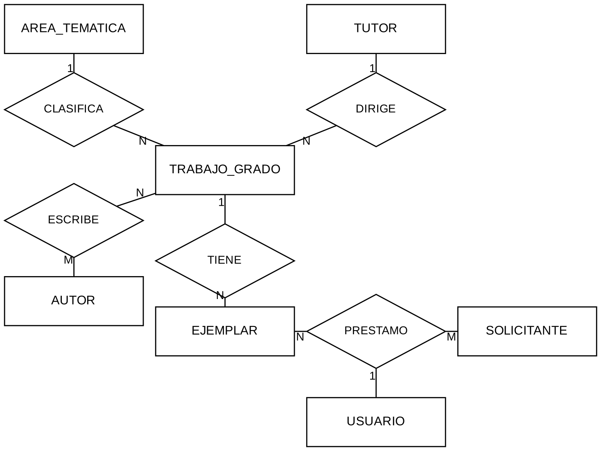

# 1. Esquema de la base de datos

Motor: **SQLite** (un solo archivo, `instance/biblioteca.sqlite3`). El esquema ejecutable está en [`app/schema.sql`](../app/schema.sql) y se crea con `flask --app wsgi init-db`. Corresponde al modelo relacional final del Capítulo III (Tabla 13), con las diferencias listadas en [05_observaciones.md](05_observaciones.md).

## 1.1 Relaciones

| Relación | Cardinalidad | Cómo se implementa |
|---|---|---|
| Área temática — Trabajo de grado | 1 : N | `trabajo_grado.id_area` → `area_tematica` (ON DELETE SET NULL) |
| Tutor — Trabajo de grado | 1 : N | `trabajo_grado.id_tutor` → `tutor` (ON DELETE SET NULL) |
| Autor — Trabajo de grado | N : M | tabla intermedia `trabajo_autor` (PK compuesta) |
| Trabajo de grado — Ejemplar | 1 : N | `ejemplar.id_trabajo` → `trabajo_grado` (ON DELETE CASCADE) |
| Ejemplar — Préstamo | 1 : N | `prestamo.id_ejemplar` → `ejemplar` |
| Solicitante — Préstamo | 1 : N | `prestamo.id_solicitante` → `solicitante` |
| Usuario — Préstamo | 1 : N | `prestamo.id_usuario` → `usuario` (quién registró) |

## 1.2 Tablas

### usuario
| Columna | Tipo | Restricciones |
|---|---|---|
| id_usuario | INTEGER | **PK**, autoincremental |
| nombre_usuario | TEXT | NOT NULL, UNIQUE, 3–30 caracteres |
| contrasena | TEXT | NOT NULL; **hash** (Werkzeug), nunca texto simple (RNF02) |
| rol | TEXT | NOT NULL, `administrador` \| `consulta` (por defecto `consulta`) |
| activo | INTEGER | NOT NULL, 0/1 (por defecto 1) |

### area_tematica
| id_area INTEGER **PK** | nombre TEXT NOT NULL **UNIQUE** (≤ 60) |
|---|---|

### tutor
| id_tutor INTEGER **PK** | nombre TEXT NOT NULL **UNIQUE** (≤ 80) |
|---|---|

### autor
| Columna | Tipo | Restricciones |
|---|---|---|
| id_autor | INTEGER | **PK** |
| nombre | TEXT | NOT NULL (≤ 80) |
| ci | TEXT | NOT NULL, por defecto `''` (≤ 15) |

### trabajo_grado
| Columna | Tipo | Restricciones |
|---|---|---|
| id_trabajo | INTEGER | **PK** |
| titulo | TEXT | NOT NULL (≤ 250) |
| resumen | TEXT | NOT NULL, por defecto `''` |
| gestion | INTEGER | NOT NULL, entre 1980 y 2100 |
| modalidad | TEXT | NOT NULL: `tesis` \| `proyecto` \| `dirigido` |
| fecha_recepcion | TEXT | NOT NULL, AAAA-MM-DD |
| cd_entregado | INTEGER | NOT NULL, 0/1 |
| autoriza_publicacion | INTEGER | NOT NULL, 0/1 |
| id_area | INTEGER | **FK** → area_tematica |
| id_tutor | INTEGER | **FK** → tutor |
| activo | INTEGER | NOT NULL, 0/1 — baja lógica (RF04) |

Índices: `ux_trabajo_titulo_gestion` (**UNIQUE** sobre `lower(titulo), gestion`, evita duplicados – RNF05), `ix_trabajo_area`, `ix_trabajo_gestion`.

### trabajo_autor
| id_trabajo **PK, FK** → trabajo_grado (CASCADE) | id_autor **PK, FK** → autor (CASCADE) |
|---|---|

### ejemplar
| Columna | Tipo | Restricciones |
|---|---|---|
| id_ejemplar | INTEGER | **PK** |
| id_trabajo | INTEGER | NOT NULL, **FK** → trabajo_grado (CASCADE) |
| codigo | TEXT | NOT NULL, **UNIQUE** (≤ 20) |
| ubicacion | TEXT | NOT NULL (≤ 60) |
| estado | TEXT | `disponible` \| `en_consulta` \| `en_prestamo` \| `baja` |

Índice: `ix_ejemplar_trabajo`.

### solicitante
| Columna | Tipo | Restricciones |
|---|---|---|
| id_solicitante | INTEGER | **PK** |
| nombre | TEXT | NOT NULL (≤ 80) |
| ci | TEXT | NOT NULL, **UNIQUE** (≤ 15) |
| matricula | TEXT | por defecto `''` (≤ 15) |
| tipo | TEXT | `estudiante` \| `docente` |
| telefono | TEXT | por defecto `''` (≤ 15) |

Índice: `ix_solicitante_matricula`.

### prestamo
| Columna | Tipo | Restricciones |
|---|---|---|
| id_prestamo | INTEGER | **PK** |
| id_ejemplar | INTEGER | NOT NULL, **FK** → ejemplar |
| id_solicitante | INTEGER | NOT NULL, **FK** → solicitante |
| id_usuario | INTEGER | NOT NULL, **FK** → usuario |
| tipo | TEXT | `interno` (consulta en sala) \| `externo` (a domicilio) |
| garantia | TEXT | `ci` \| `matricula` \| `ninguna` |
| fecha_prestamo | TEXT | NOT NULL |
| fecha_devolucion_prevista | TEXT | NOT NULL |
| fecha_devolucion_real | TEXT | NULL hasta devolver |
| renovaciones | INTEGER | ≥ 0 |
| estado | TEXT | `vigente` \| `devuelto` (el estado **vencido se calcula**, no se guarda) |

Índices: `ix_prestamo_estado`, `ix_prestamo_solicitante`, `ix_prestamo_ejemplar` y el **índice único parcial** `ux_prestamo_ejemplar_vigente` (`WHERE estado='vigente'`): la propia base impide dos préstamos vigentes del mismo ejemplar, aunque falle la validación de la aplicación.

## 1.3 Normalización
El modelo está en **3FN**: los atributos repetibles (autores, ejemplares) se separaron en tablas propias (1FN); ningún atributo depende de parte de una clave compuesta (2FN); y área, tutor y solicitante son tablas independientes, sin dependencias transitivas (3FN). El diagrama de dependencias del préstamo está en [`img/dependencias_prestamo.png`](img/dependencias_prestamo.png).
