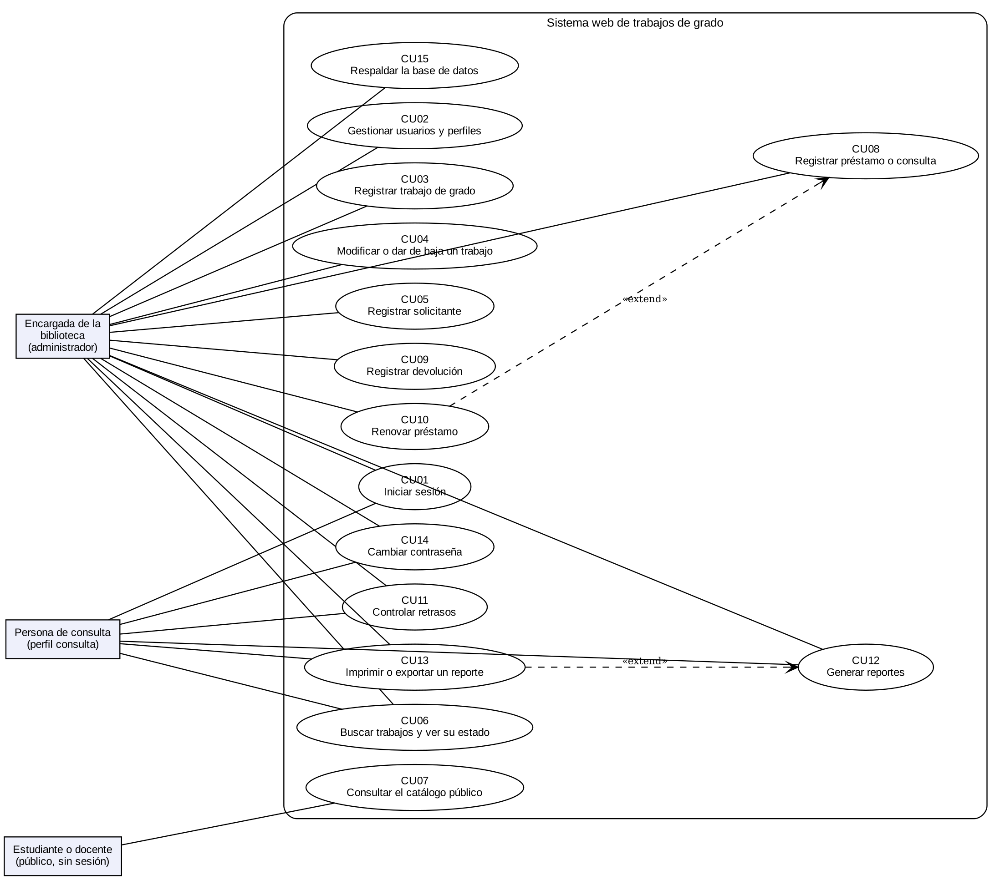

# 4. Casos de uso

## 4.1 Actores
- **Encargada de la biblioteca (administrador):** opera todo el sistema.
- **Persona de consulta (perfil consulta):** inicia sesión, busca y ve reportes; no registra ni modifica.
- **Estudiante o docente (público):** solo consulta el catálogo público, sin sesión.

Todos los casos de uso, excepto **CU07**, requieren haber realizado **CU01 Iniciar sesión**.

## 4.2 Resumen

| Código | Caso de uso | Actor | Req. |
|---|---|---|---|
| CU01 | Iniciar sesión | Encargada, Consulta | RF01 |
| CU02 | Gestionar usuarios y perfiles | Encargada | RF02 |
| CU03 | Registrar trabajo de grado | Encargada | RF03, RF05 |
| CU04 | Modificar o dar de baja un trabajo | Encargada | RF04 |
| CU05 | Registrar solicitante | Encargada | RF08 |
| CU06 | Buscar trabajos y ver su estado | Encargada, Consulta | RF06, RF07 |
| CU07 | Consultar el catálogo público | Público | — |
| CU08 | Registrar préstamo o consulta | Encargada | RF09 |
| CU09 | Registrar devolución | Encargada | RF10 |
| CU10 | Renovar préstamo | Encargada | RF10 |
| CU11 | Controlar retrasos | Encargada, Consulta | RF17 |
| CU12 | Generar reportes | Encargada, Consulta | RF11–RF19 |
| CU13 | Imprimir o exportar un reporte | Encargada, Consulta | RF20 |
| CU14 | Cambiar contraseña | Encargada, Consulta | RF01 |
| CU15 | Respaldar la base de datos | Encargada | RNF |

## 4.3 Fichas

**CU01 Iniciar sesión.** *Precondición:* usuario activo. *Flujo:* 1) ingresa nombre y contraseña; 2) el sistema valida; 3) crea la sesión y muestra Inicio. *Alternos:* credenciales incorrectas → mensaje genérico; 5 intentos fallidos → bloqueo de 5 minutos; usuario inactivo → rechazo. *Postcondición:* sesión abierta con su rol.

**CU02 Gestionar usuarios y perfiles.** *Pre:* rol administrador. *Flujo:* lista usuarios → crea o edita (nombre, rol, clave) → guarda. *Alternos:* nombre repetido o clave débil → error; intentar desactivarse a sí mismo → rechazado. *Post:* usuario creado, editado o activado/desactivado.

**CU03 Registrar material bibliográfico.** *Pre:* administrador con sesión. *Flujo:* completa título, resumen, gestión, modalidad (tesis, proyecto, dirigido o libro), autores, tutor, área, CD, autorización y cantidad de ejemplares → el sistema valida → guarda el material, autores y ejemplares con código y estado disponible. *Alternos:* título y gestión ya existentes → rechazo; datos inválidos → se muestran los errores. *Post:* material visible en el catálogo interno.

**CU04 Modificar o dar de baja.** *Pre:* material existente. *Flujo:* edita datos → guarda; o pide baja → el sistema la registra (lógica) y marca ejemplares en baja. *Alterno:* si algún ejemplar tiene préstamo vigente, la baja se rechaza. *Post:* datos actualizados o material inactivo.

**CU05 Registrar solicitante.** *Flujo:* ingresa nombre, CI, matrícula, tipo, teléfono → guarda. *Alterno:* CI repetida → error. *Post:* solicitante disponible para préstamos.

**CU06 Buscar material y ver su estado.** *Flujo:* ingresa texto y filtros (incluida la modalidad «Libro») → el sistema lista resultados paginados → abre la ficha con ejemplares y disponibilidad. *Alterno:* sin resultados → mensaje. La búsqueda ignora tildes y mayúsculas.

**CU07 Consultar el catálogo público.** *Pre:* catálogo público activado. *Flujo:* el visitante busca y ve título, autores, gestión, área y disponibilidad. *Nota:* no muestra solicitantes ni préstamos; solo trabajos activos que autorizan publicación.

**CU08 Registrar préstamo o consulta.** *Pre:* ejemplar disponible y solicitante registrado. *Flujo:* indica ejemplar, CI o matrícula del solicitante, tipo y garantía → el sistema valida reglas → registra con fecha prevista y cambia el estado del ejemplar → muestra comprobante. *Alternos:* ejemplar no disponible; solicitante inexistente (se sugiere CU05); más de 2 externos vigentes → rechazo. *Post:* préstamo vigente.

**CU09 Registrar devolución.** *Pre:* préstamo vigente. *Flujo:* selecciona el préstamo → confirma → el sistema guarda fecha real, marca devuelto y el ejemplar vuelve a disponible. *Alterno:* préstamo ya devuelto → error.

**CU10 Renovar préstamo** (extiende CU08). *Pre:* préstamo externo vigente, sin renovaciones previas (máx. 1). *Flujo:* solicita renovación → el sistema amplía la fecha prevista. *Alterno:* límite alcanzado → rechazo.

**CU11 Controlar retrasos.** *Flujo:* el sistema destaca en Inicio y en el reporte de alertas los préstamos vigentes con fecha prevista vencida y los días de retraso.

**CU12 Generar reportes.** *Flujo:* elige uno de los 9 reportes, define filtros o fechas → el sistema los muestra con totales y gráfico de barras cuando aplica.

**CU13 Imprimir o exportar un reporte** (extiende CU12). *Flujo:* pulsa «Imprimir / guardar en PDF» (estilo de impresión limpio) o exporta a CSV.

**CU14 Cambiar contraseña.** *Flujo:* ingresa la clave actual y la nueva → el sistema valida y guarda el hash. *Alterno:* clave actual incorrecta o nueva corta → error.

**CU15 Respaldar la base de datos.** *Flujo:* el administrador ejecuta `flask --app wsgi backup` → se crea una copia con fecha en `instance/respaldos/`.
